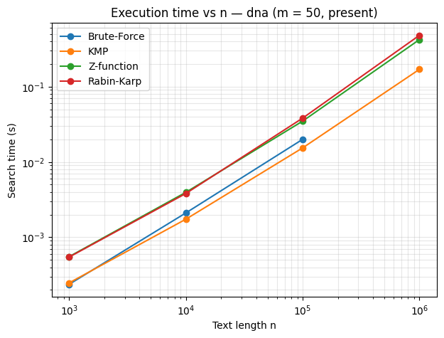
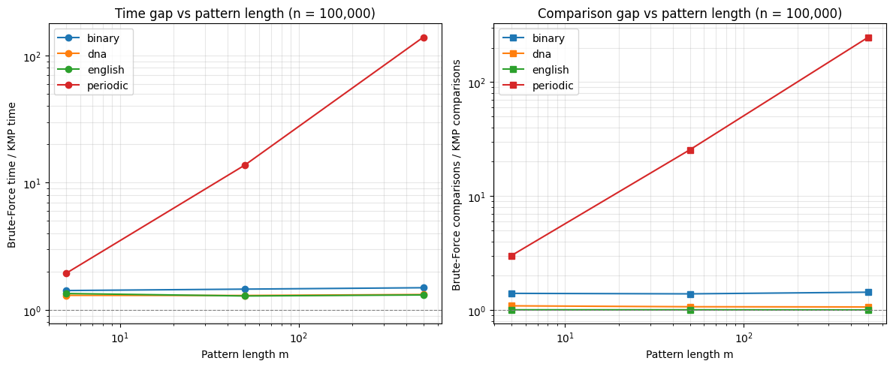

# String Matching Algorithms: Implementation & Benchmark

Python implementations of four exact string matching algorithms (Brute-Force, Knuth-Morris-Pratt, Z-function and Rabin-Karp), benchmarked on real DNA sequences, English literature and two generated worst-case texts. Built for the Data Structures & Algorithms course (INS3050) at VNU International School.

## Key findings

- **KMP is the fastest of the four once texts grow beyond a few thousand characters**, on every corpus: about 0.16–0.28 s to search 1 million characters, scaling linearly with text length.
- **The Z-function is also linear but 2.3–2.8 times slower than KMP**, because it builds an auxiliary array over the whole text.
- **Rabin-Karp's cost comes from hashing, not collisions:** raising the modulus cut false positives from about 10,000 to 0, but search time did not fall.
- **Brute-Force is only 1.3–1.5 times slower than KMP on natural text, but up to 139 times slower on periodic text**, and the gap grows with pattern length (2× at m = 5, 14× at m = 50, 139× at m = 500).
- Python's built-in `str.find`, written in C, is 23–430 times faster than the Python KMP on DNA, English and binary text, but no faster on periodic text. The benchmark therefore compares algorithmic behaviour, not raw speed.

## Algorithms

| Algorithm | Preprocessing | Worst case | Extra space |
|---|---|---|---|
| Brute-Force | none | Θ(n·m) | O(1) |
| KMP | Θ(m) | Θ(n + m) | Θ(m) |
| Z-function | none | Θ(n + m) | Θ(n + m) |
| Rabin-Karp | Θ(m) | O(n·m) | O(1) |

All four implementations were cross-checked against a naive reference on 400 random cases before timing.

## Data

| Corpus | Source | Alphabet size | Purpose |
|---|---|---|---|
| `dna` | [Kaggle DNA sequence dataset](https://www.kaggle.com/datasets/nageshsingh/dna-sequence-dataset) (human sequences), 5.5M characters | 4 | small alphabet, high repetition |
| `english` | Project Gutenberg texts via NLTK, 11.7M characters | 96 | natural language |
| `binary` | generated | 2 | extreme small alphabet |
| `periodic` | generated `abab…` | 2 | worst case for Brute-Force |

## Method

- Text lengths n = 10³ to 10⁶; pattern lengths m = 5, 50 and 500.
- Three pattern types: present (sampled from the text), absent, and degenerate (one repeated character).
- Each run repeated 3 times; mean and minimum time recorded, plus character comparisons.
- Extra experiments: Rabin-Karp modulus sweep and a `str.find` baseline.

## Files

| File | Contents |
|---|---|
| `string_matching.ipynb` | pseudocode, implementations, benchmark and charts |
| `report.pdf` | final group report |

## How to run

1. Download `human.txt` from the Kaggle dataset above.
2. Open `string_matching.ipynb` in Jupyter or Google Colab, upload `human.txt` to the same folder, and run all cells. The English corpus downloads automatically through NLTK.

Requirements: Python 3, pandas, matplotlib, nltk.

## Team

Group 7, INS3050: Mạc Hải Nam (implementation, benchmarking and figures), Dương Thu Phượng, Hà Phương Thảo, Nguyễn Thanh Tùng.
